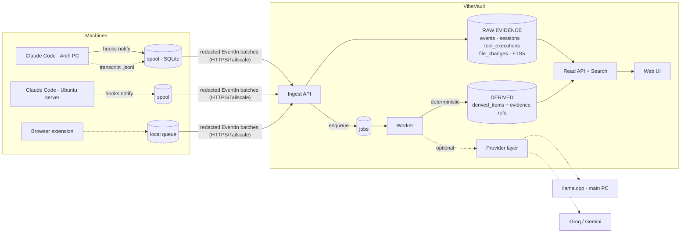

# Architecture

One deployable (a FastAPI process with an in-process worker thread) plus SQLite. No microservices,
no vector database, no required external service.

## The ten boundaries

| # | Boundary | Where |
|---|---|---|
| 1 | Core data model + ingestion API | `schemas.py`, `ingest.py`, `api/routes.py` |
| 2 | Persistent raw-event archive | `models.py` (events, tool_executions, file_changes), `raw_payload` |
| 3 | Projects & sessions | `models.py`, `ingest.resolve_project`, alias endpoints |
| 4 | Full-text search | `search.py`, FTS5 table + triggers in migration `0001` |
| 5 | AI-derived knowledge | `derived_items` / `derived_evidence`, `knowledge.py` |
| 6 | Background queue | `jobs.py`, `worker.py`, `handlers.py` |
| 7 | Provider adapters | `providers/` |
| 8 | Collectors / extension | `collectors/` (implemented), `extension/` (implemented) |
| 9 | Web UI | `frontend/` |
| 10 | Deployment/ops | `Dockerfile`, `docker-compose.yml`, `cli.py` (backup/restore/prune) |

## Key decisions

**Raw and derived data never mix.** Raw tables are append-only from the API's point of view:
an edit is a *new revision*, a conflicting re-send is rejected as `conflict` and the original is
kept. Derived rows live in separate tables, always carry `origin`, `epistemic_status`,
`generation_id`, provider/model/prompt version and *evidence references*. Regenerating
knowledge only creates a new generation and supersedes old model output; it never touches events.
The UI renders the two with different visual treatment and labels.

**Epistemic status is enforced, not advisory.** Model output can only be `inferred`,
`hypothesis` or `unresolved`; a model claiming `confirmed` is coerced to `inferred`; items
without valid evidence references are dropped; only an admin action (`POST /derived/{id}/confirm`) or a
purely deterministic computation yields `confirmed`. Regeneration keeps human-confirmed items.

**Idempotency by identity.** An event's identity is `(source, device_id, external_event_id, revision)`;
its server ID is a UUIDv5 of that tuple, so the same event has the same ID across retries, restores
and even separate server instances. Same identity + same semantic content → `duplicate`; same identity +
different content → `conflict`. Content hash covers type/actor/content/tool/file changes only,
not transport details like redaction bookkeeping.

**Ordering.** Sessions/events are created on demand and in any order. Reads order by
`(occurred_at, COALESCE(sequence,0), ingest seq)`. Collectors without trustworthy timestamps must
assign monotonically increasing ones. `is_current` selects the highest revision regardless of arrival order.
Parent/child and tool call↔result links are by *external* IDs resolved at read time, so a
result arriving before its call is paired when the call lands.

**Ingestion never depends on AI.** Redaction, indexing (FTS triggers) and session bookkeeping are
synchronous and deterministic. Everything else is queued. With no provider configured the system is
fully functional except AI jobs, which cannot even be enqueued (409).

**Job queue on the same SQLite DB.** Jobs: `pending → running → completed | failed`.
Claim is one atomic `UPDATE … RETURNING`; a lease (heartbeat) protects running jobs; expired leases
are recovered on the next tick *and count as an attempt*. Retry uses bounded exponential backoff
(`base·2^(n-1)`, capped). `Continue` (more work, progress checkpointed) and `Defer` (rate limited,
no provider) don't consume attempts. A partial unique index enforces one active job per
`dedupe_key`. A periodic sweeper re-creates jobs for any unprocessed events, so a lost job heals.
Handlers must be idempotent; the digest and summarize handlers resume from `checkpoint`.

**Security model.** Two token scopes (`admin`, `ingest`); the server refuses to start without an
admin token; tokens are compared in constant time and never logged; error responses and logs never echo
request payloads (validation errors are sanitized); 413 on oversized bodies (also chunked).
The service is intended for a private network; it ships without TLS (terminate with Tailscale/your proxy).

**PostgreSQL path.** All access is SQLAlchemy 2.0 ORM/Core; custom types are dialect-neutral
(`UTCDateTime`, JSON). SQLite-specific parts are isolated and listed: (1) FTS5 table/triggers
(migration `0001`, guarded by `dialect.name`) and `search.py` → replace with a generated `tsvector` +
GIN index and `websearch_to_tsquery`; (2) the `UPDATE … RETURNING` claim in `jobs.claim` (works as-is on
PostgreSQL; add `FOR UPDATE SKIP LOCKED` for multiple workers); (3) WAL pragmas in `db.py`;
(4) the partial unique index is already declared for both dialects. No abstraction layer was built
for this; the work is a second migration set plus `search.py`.

## What is deliberately not here

Vector search/embeddings, multi-user accounts, TLS termination, remote orchestration of the main PC
(Wake-on-LAN/shutdown), any endpoint that executes commands, automatic execution of anything derived
from archived content.
