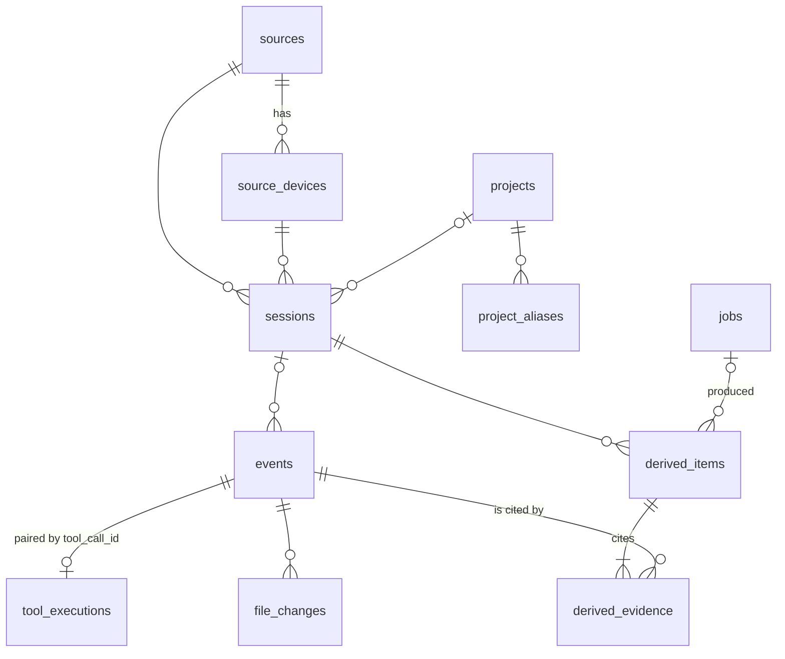

# Database schema

Migrations: `src/vibevault/migrations` (Alembic). `vibevault migrate` or automatic on start.
Current head: `0001` (schema + FTS5).

## Raw evidence

| Table | Purpose / notable columns |
|---|---|
| `sources` | kind (`claude_code`, `chatgpt_web`, …) |
| `source_devices` | `(source, device_key)`, label, `collection_enabled`, first/last seen |
| `projects` | slug, name, `collection_enabled`, `ai_processing_enabled` |
| `project_aliases` | normalized source identity → project (unique) |
| `sessions` | `(source, device, external_session_id)` unique; nullable `project_id` + `project_hint` (unresolved identity); `started_at/last_event_at/ended_at`, `status` open/ended, `excluded` (tombstone), `event_count` |
| `events` | `seq` (integer PK = ingest order and FTS rowid), `id` (UUIDv5, unique), source/device/session FKs (session nullable), external ids, `revision`, `is_current`, project (nullable) + hint, `event_type`, `actor`, `occurred_at`, `ingested_at`, `ingested_by`, `sequence`, `content`, `content_hash`, `metadata` JSON, `parent_external_event_id`, `tool_call_id`, `redaction_status/count/rules`, `processing_status`, `raw_payload`, `raw_payload_ref`. Unique `(source, device, external_event_id, revision)` |
| `tool_executions` | one row per `(source, device, tool_call_id)`; call and result halves merge (name, command, input, output, exit_code, is_error, event links) |
| `file_changes` | per event: path, operation, diff, hashes |
| `events_fts` | FTS5 external-content index over `events.content` (porter + unicode61), maintained by insert/update/delete triggers |

## Operations
`jobs` (kind, `dedupe_key`, status, payload, `checkpoint`, result, attempts/max, `run_after`, lease, `last_error`, `status_note`),
`audit_log` (actor, action, target, detail — counts/ids only), `provider_usage` (per provider per UTC day).

## Derived knowledge
`derived_items`: `kind` (digest, summary, decision, error_resolution, task, fact, dependency, contradiction),
`origin` (deterministic/model/human), `epistemic_status` (confirmed/inferred/hypothesis/unresolved),
`state` (draft/active/superseded), `generation_id`, provider/model/prompt_version, confidence (model self-reported),
confirmation fields. `derived_evidence(derived_id, event_id)` links every item to raw events.
Nothing in this layer is referenced by a raw table.
